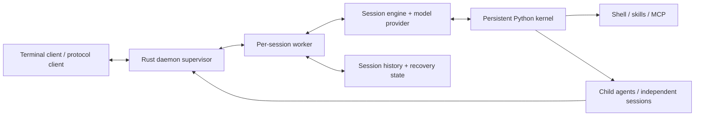

<h1 align="center">Prime Native</h1>
<p align="center"><strong>Give an agent a working environment, not just a chat window.</strong></p>
<p align="center">Persistent Python · Rust session engine · Background agents · Durable handoffs</p>
<p align="center">
  <a href="#why-this-fork">Why this fork</a> ·
  <a href="#try-it-from-source">Quickstart</a> ·
  <a href="#what-working-with-it-looks-like">Example</a> ·
  <a href="#inside-the-runtime">Architecture</a>
</p>

Prime Native is an independently maintained fork of [Prime Agent](https://github.com/PrimeIntellect-ai/prime-agent), focused on long-running, programmatic agent work. The model can keep data in a Python REPL, launch commands, delegate work, and return to results without turning every step into another manual chat exchange.

**The reason to use this fork is coordination that follows the work:** a returned handle is not a finished task, a finished turn is not necessarily a settled session, and a completion notice is not acceptance of the result.

This repository contains the **Native Rust engine, Python runtime, terminal UI, skills, and tests**. It is a standalone source snapshot, published without imported Git history—not an official Prime Intellect distribution or the complete private Studio/host deployment.

## Why this fork

Upstream already provides the foundations: the [Recursive Language Model](https://www.primeintellect.ai/blog/rlm) approach, a persistent REPL, recursive agents, and the continual harness. We build on those ideas rather than claim them as our own.

The fork adds concrete machinery around the awkward parts of longer jobs:

| When the work gets complicated | What this fork adds |
| --- | --- |
| A coordinator starts an independent session and needs its result later | **Opt-in session completion subscriptions.** `rlm.create_session(..., completion=...)` routes a factual settled-result notice to the durable creator's follow-up queue. Background commands, subagents, queued work, and pending continuation delay settlement. [Runtime API](prime-agent-runtime/src/rlm/__init__.py) · [delivery implementation](crates/pa-daemon/src/worker/session_completion.rs) |
| Agents exist, but it is unclear which ones actually own the task | **Task-scoped orchestration state.** Assignment bindings include task generations and worker incarnations; fresh status distinguishes executing work from queued or uncertain admission. Configured gates can hold the management boundary rather than treat a cached roster as progress. [Implementation](crates/pa-daemon/src/rlm_children/orchestration.rs) · [behavioral tests](crates/pa-daemon/tests/orchestration_gate_e2e.rs) |
| A headless owner reaches the end of a turn while its goal still owes work | **Continuation-aware waiting.** The worker tracks pending goal continuation, background work, retry activity, and wake sources before declaring settlement. It also connects goal continuation to the orchestration boundary. [Goal continuation](crates/pa-daemon/src/goal_continuation.rs) · [worker tests](crates/pa-daemon/src/worker/tests/goal_tests.rs) |

These differences are relative to upstream snapshot [`c6d4da942`](https://github.com/PrimeIntellect-ai/prime-agent/tree/c6d4da9421e6087e3fc1a763e947cf37153cd76f), not a claim that upstream lacks every related feature or that either project will remain unchanged.

### The useful foundations are still here

- **Code as the control surface.** Keep intermediate results in Python variables. Use loops, parsing, and async calls instead of copying tool output back into prompts.
- **Sessions beyond a terminal connection.** A daemon supervises session workers; saved history and kernel snapshots support reattachment and recovery. Persistence is best-effort for Python objects that cannot be serialized.
- **Parallel work when it helps.** Recursive children use `rlm.spawn`; independent daemon-backed root sessions use `rlm.create_session`. Agents can exchange messages directly.
- **Context management you can tune.** Automatic and manual compaction, persistent goals, bounded autonomous mode, heartbeats, and schedules support longer tasks. `/settings` exposes the automatic compaction percentage; model-specific context windows can be configured separately.
- **A continual harness.** `/refine` records focused changes to supplemental prompts, memories, skills, and subagent specifications. It does not rewrite the immutable base system prompt.
- **Extensible tools.** Markdown and executable Python skills sit alongside MCP integrations. Credentials and service setup remain yours.

## Try it from source

Use this repository's source—not the upstream binary installer—to try this fork. You need Git, a current Rust/Cargo toolchain, a supported native build environment, and network access for the first dependency/runtime setup. The kernel uses Python 3.11; its bootstrap can provision Python, `uv`, and Python packages.

```bash
git clone https://github.com/chip-demi/prime-native.git
cd prime-native

# Keep the Python sidecar and bundled assets tied to this checkout.
export PI_PACKAGE_DIR="$PWD"

# Build and launch the Native terminal client.
cargo run --locked -p pa-cli --bin prime-agent --
```

This is a POSIX-shell source-development example. The first launch/kernel use can download dependencies and create a kernel environment. The [bootstrap code](crates/pa-core/src/kernel/bootstrap/mod.rs) documents the advanced `PRIME_AGENT_KERNEL_VENV` and `PRIME_AGENT_KERNEL_PYTHON` overrides. An explicit Python override must already contain the current local runtime and required packages; an arbitrary system Python is not enough.

Inside the client:

1. Use `/login` to configure a supported provider with your own credentials.
2. Use `/model` to select a model available to that provider.
3. Start with a small task in a disposable project or worktree and inspect the result.

**Models and costs are user-configured.** This source does not include API credits, a hosted model subscription, or a free inference service. Agent and subagent requests consume your provider's resources; configure models and budgets for your workload. Not every upstream authentication flow is implemented in Native—see [the CLI scope](crates/pa-cli/README.md).

After building, the same binary exposes session discovery and reattachment:

```bash
./target/debug/prime-agent agents
./target/debug/prime-agent attach <agent>
./target/debug/prime-agent --resume
./target/debug/prime-agent status
```

Keep `PI_PACKAGE_DIR` pointing at the trusted checkout when launching elsewhere. For work in another project, launch the built binary from that project's directory. A distributable package needs the matching Python sidecar and assets, not just the executable; see [packaged layout](crates/pa-cli/README.md#packaged-layout--kernel-packaging).

> The included installers, release workflows, and updater retain upstream-oriented routes. They are not a qualified distribution/update channel for this fork. Do not run the stock updater over a custom installation expecting these changes to survive.

## What working with it looks like

The following is code the agent can run **inside its persistent Python REPL**, not a standalone SDK script. Top-level `await` is supported, and variables remain available across cells.

```python
# Launch a read-only command and keep the handle for later inspection.
job = bash("git status --short")
status = await job
print(status.output)
```

For an independent task, a daemon-backed depth-0 session can create another root session and opt into a completion notice:

```python
review = await rlm.create_session(
    "Read this project's README and source. Write a short setup review "
    "to review-notes.md. Do not modify other files or install anything.",
    name="setup-review",
    completion={
        "assignment_id": "setup-review",
        "artifact_ref": "review-notes.md",
    },
)
print(review.session_id)
```

The model and working directory inherit from the creator unless explicitly supplied. `rlm.find_models()` discovers available selectors; use the returned selector when choosing another model. The returned handle confirms creation and initial prompt submission, **not task completion**. The artifact reference identifies the requested output; the agent still has to write it.

The optional `completion` argument subscribes the creator to a settled-result notice through its existing follow-up queue. The creator should then inspect `review-notes.md` and decide whether the assignment is satisfied. Without `completion`, session creation still works, but does not subscribe to this notice.

An owner stop remains a stop. If delivery becomes **UNKNOWN**, reconcile receipts/state rather than blindly resending the assignment. The implementation does not promise guaranteed delivery or globally exactly-once external effects.

## Inside the runtime



The separation is practical: the terminal renders state, the daemon supervises workers, and the Python kernel holds the agent's programmatic working context. It is **process separation, not a security sandbox**. Model-generated Python, shell commands, skills, and tools run with the permissions of their configured environment. Use an external sandbox or restricted account for untrusted work.

| Source | Responsibility |
| --- | --- |
| [pa-cli](crates/pa-cli/README.md) / [pa-tui](crates/pa-tui/README.md) | CLI composition and terminal interface |
| [pa-daemon](crates/pa-daemon/README.md) | Workers, session queues, supervision, messaging, recovery |
| [pa-core](crates/pa-core/README.md) | Session engine, kernel bootstrap, settings, skills, harness |
| [pa-ai](crates/pa-ai/README.md) / [pa-models](crates/pa-models/README.md) | Providers, streaming, model registry/catalog |
| [prime-agent-runtime](prime-agent-runtime/src/rlm) | Python REPL and host-facing RLM API |

### Native core vs. deployment integrations

The source includes integration seams for managed launches, owner controls, Drone, and Studio-linked task orchestration. Those are not a bundled web application or a ready-made managed hosting service. Private Studio UI, host launchers/policies, deployment configuration, credentials, and runtime sessions are outside this repository's deliverable. Host attestation requires its own supported Linux/root/systemd setup; Drone requires the provider/model configuration its implementation expects. A source checkout alone does not configure those integrations.

You can use the terminal, Native sessions, REPL, and ordinary tools without reproducing a private deployment. If you extend managed behavior, start with the [Native integration boundaries and focused upgrade checks](docs/private-native-upgrades.md).

## More documentation

- [Slack MCP](docs/slack-mcp.md) and [Google Drive / Sheets MCP](docs/google-workspace-mcp.md): service-specific OAuth and connector setup.
- [Daily stats](docs/daily-stats.md): usage reporting.
- [Development rules](AGENTS.md), [contribution guidance](CONTRIBUTING.md), and [Makefile](Makefile): crate ownership and verification commands. Some inherited contribution/release guidance targets upstream; fork-specific work belongs in [this repository's issues](https://github.com/chip-demi/prime-native/issues).
- [Legacy upgrade contract](docs/legacy-upgrade-contract.md): compatibility context, not a recommendation to install upstream over this fork.

<details>
<summary>Terminal clipboard and custom certificate authorities</summary>

Clipboard integration uses a local clipboard tool when available, tmux client forwarding when supported, and OSC 52 for other remote terminals. Terminal delivery requests cannot confirm that your local clipboard changed. Nested tmux or terminal policy may block them; native terminal selection remains an alternative.

HTTPS trusts OS roots together with bundled Mozilla roots. For a custom CA, set `NODE_EXTRA_CA_CERTS` to your PEM bundle before starting the client/daemon. Existing daemon processes keep their startup environment; changing a shell variable does not update them. Coordinate any daemon shutdown with active sessions.

</details>

## Credit and license

Built on [PrimeIntellect-ai/prime-agent](https://github.com/PrimeIntellect-ai/prime-agent). The RLM and continual-harness foundations, much of this implementation, and the original research belong to the upstream project and its contributors. The [LICENSE](LICENSE) retains the MIT terms and the Prime Intellect and Mario Zechner notices; third-party notices remain with their components.

For research using Prime Agent, please cite the upstream work:

```bibtex
@article{karten2026prime,
  title={Prime Agent: A Self-Improving RLM Harness},
  author={Karten, Seth and Zhang, Alex L. and Thomas, Kevin and Müller, Sebastian and Bakouch, Elie and Auras, Daniel and Senghaas, Mika and Obeid, Fares and Dunas, Konstantin and Hagemann, Johannes and Jaghouar, Sami},
  journal={arXiv preprint arXiv:2608.23552},
  year={2026}
}
```

[Paper](https://arxiv.org/abs/2608.23552) · [Continual Harness](https://arxiv.org/abs/2605.09998) · [Verifiers](https://github.com/PrimeIntellect-ai/verifiers) · [PRIME-RL](https://github.com/PrimeIntellect-ai/prime-rl)
